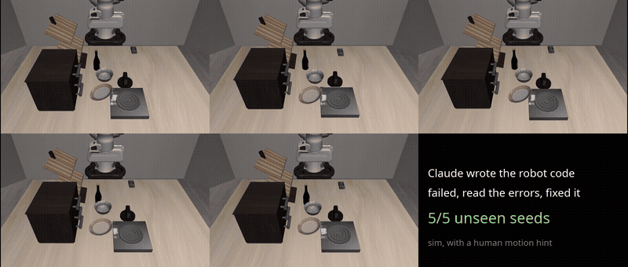

# robot-skill-memory

**Claude writes robot-arm programs, watches them fail, and fixes them. Does giving it a skill library help?**

A small experiment on top of NVIDIA's [ASPIRE](https://github.com/NVlabs/ASPIRE) harness
([paper](https://arxiv.org/abs/2607.00272)) and LIBERO-Pro. Simulation only (MuJoCo, Franka arm).
This is an independent project and not affiliated with NVIDIA or Anthropic.

Videos: [highlights](media/hero.mp4) · [the two bugs Claude fixed](media/stove_two_bugs.mp4)

## Loop
1. **Write:** Claude Sonnet (Claude Code CLI, no tools) gets the robot API, the task, its BDDL scene file and
   optionally skill notes. It writes one Python program. Nothing is trained.
2. **Run:** the program runs alone. SAM3 + depth locate objects, PyRoki does IK.
3. **Fix:** on failure Claude gets the errors and the last camera frame of the first failed seed, and rewrites
   the program (up to 5 times, on 3 practice seeds).
4. **Test:** the frozen program runs on 5 other seeds. The simulator decides success.

A seed moves objects within a box of about 2 cm. The arrangement stays the same, so these are unseen seeds,
not new layouts.

## Best programs
These are the best across runs and memory conditions, **not averages**.

| Task | First program | After rewrites | Run, condition | Human motion hints |
|---|---|---|---|---|
| Turn on the stove | 0/5 | **5/5** (1 rewrite) | 4, C | yes |
| Bowl on the plate | 0/5 | **5/5** (4 rewrites) | 3, D | general prompt rules only |
| Bowl on the stove | 0/5 | **3/5** (1 rewrite) | 4, C | yes |
| Push the plate | 0/5 | **0/5** | none worked | yes (run 4) |

### What the stove rewrite fixed
The first program had two bugs, both visible in the traces:
- **Wrong spot:** in 4 of 5 test runs it closed the gripper on the stove, about 15 cm from the knob.
- **Wrong direction:** in the run where it did reach the knob, it twisted against the stop.

The rewrite added a size filter and other queries to the knob detection and reversed the twist
(its comment: `previous positive twist did not turn the stove on`). See
[v1](results/programs/run4/turn_on_stove_C/v1.py) and [v2](results/programs/run4/turn_on_stove_C/v2.py).

## Every final score
| | Task | A: no notes | B: relevant notes | C: B + irrelevant notes | D: retrieved from C |
|---|---|---|---|---|---|
| Run 2 | bowl on plate | 5 | 0 | 0 | 2 |
| | bowl on stove | 0 | 0 | 0 | 0 |
| | push plate | 0 | 0 | 0 | 0 |
| | turn on stove | 0 | 0 | 0 | 0 |
| Run 3 | bowl on plate | 4 | 5 | 5 | 5 |
| | bowl on stove | 0 | 0 | 1 | 0 |
| | push plate | 0 | 0 | 0 | 0 |
| | turn on stove | 2 | 2 | 0 | not finished |
| Run 4 | bowl on stove | 0 | – | 3 | – |
| | push plate | 0 | – | 0 | – |
| | turn on stove | 0 | – | 5 | – |

All out of 5. Raw data: [summary.csv](results/summary.csv), [episodes.csv](results/episodes.csv),
[every generated program](results/programs).

What changed between runs:
- **Run 2:** 1000-step episodes, 3 rewrites. A bug sent Claude empty error messages.
- **Run 3:** 2500-step episodes, real error messages, 5 rewrites, more prompt rules about blocked moves.
- **Run 4:** human hints (below), bug fixes, fresh test seeds 6–10, weak tasks only, conditions A and C.
  The final program is the best on the practice seeds (newest on ties), instead of the last one.

Because several things changed at once, improvements can't be credited to any single change.

## Does skill memory help?
**Inconclusive.**
- The notes are used: a helper from ASPIRE's notes appears in 33/37 programs given the relevant notes and in
  0/56 given none (rewrites included).
- A better success rate is not shown. There is one generation chain per task and condition, and the winner
  flips between runs.
- Next: repeated generations per condition, with everything fixed in advance.

## Human help in Run 4
- Travel at about z = 0.30 m before moving sideways: there is no collision-aware planner in this setup.
- Treat a joint error under 0.05 rad as "arrived". The prompt gave a one-line check for this, and the winning programs use it.
- Sanity-check detections (a knob is low and next to the stove).
- Add `import math` automatically when a program forgets it.

The exact prompt is `SYSTEM` in [src/agent_study.py](src/agent_study.py).

## Limitations
- 4 tasks from one LIBERO-Pro suite, 5 test seeds each. This is not a benchmark of LIBERO-Pro.
- It is not a replication of ASPIRE. Its authors report 99% on 80 LIBERO-Pro tasks with the full system.
- The skill notes were developed on LIBERO-Pro, so conditions B, C and D may leak task knowledge.
- Programs over-report: in Run 2, one condition reported "placed" in 22/22 episodes with 0 real successes.
- In 2 of the 3 bowl-on-stove wins the arm knocks the bottle over. The success check only looks at the bowl.
- Changes from stock ASPIRE: a T4 profile, fp16 SAM3, a 300-step settle window, and an `init_states` bug fix.

## Run it
Import a notebook from [`notebooks/`](notebooks) into Kaggle (GPU T4 x2, internet on), then Save & Run All.
- Secrets: `HF_TOKEN` (with access to the gated SAM3 weights) and `CLAUDE_CODE_OAUTH_TOKEN`.
- Use `run4_motion_hints.ipynb` as the starting point. It takes about 3.5–5.5 h and up to 36 Claude calls.
- The Run 2 and 3 notebooks upload full checkpoints every 20–30 min to a private HF dataset, which can fill
  the free storage limit through version history. Run 4 uploads only small state files.

`src/` is the agent code exactly as embedded in the Run 4 notebook.

## Credit
Built on ASPIRE (Lu et al., 2026, NVIDIA GEAR and collaborators, Apache-2.0), LIBERO-Pro, SAM3 and PyRoki.
Generated programs can contain snippets from ASPIRE's skill notes. Its license and notice are in
[`third_party/ASPIRE`](third_party/ASPIRE).
